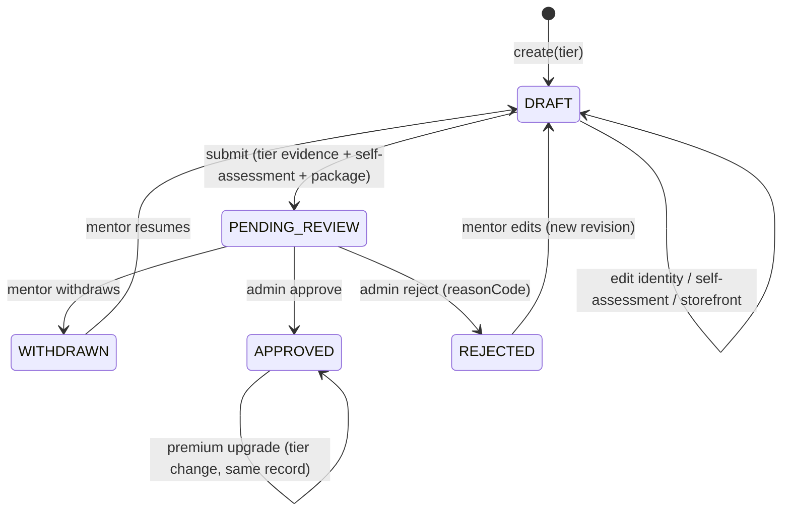
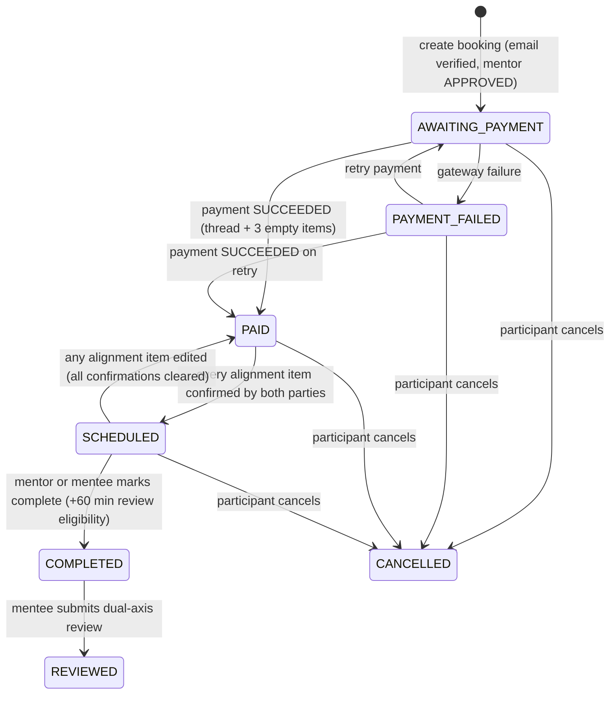
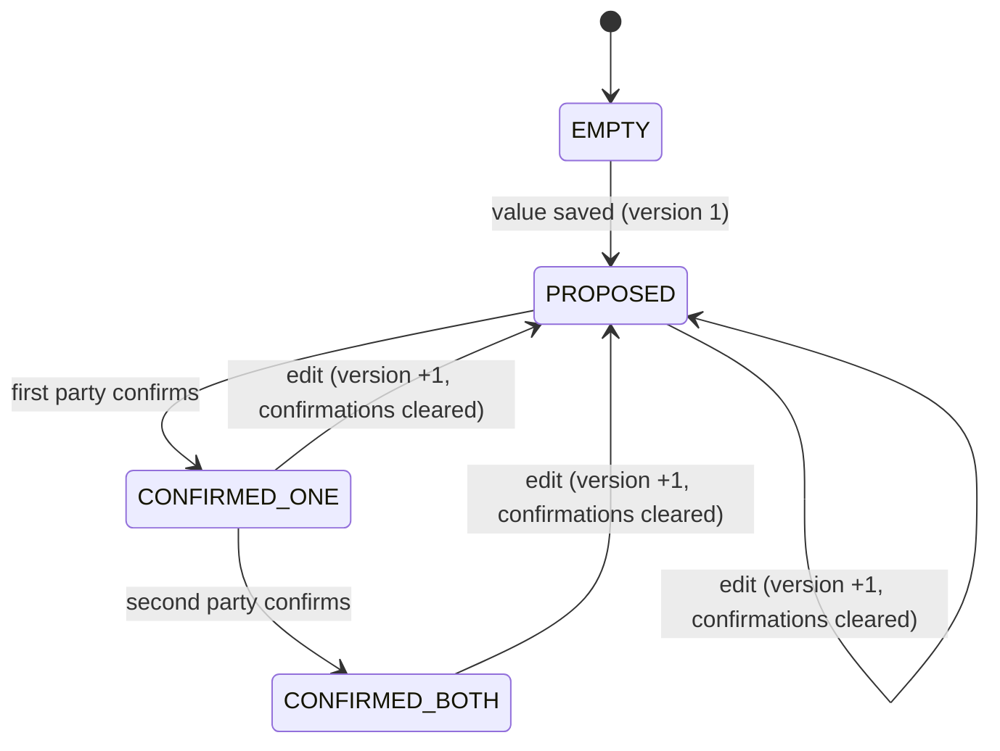
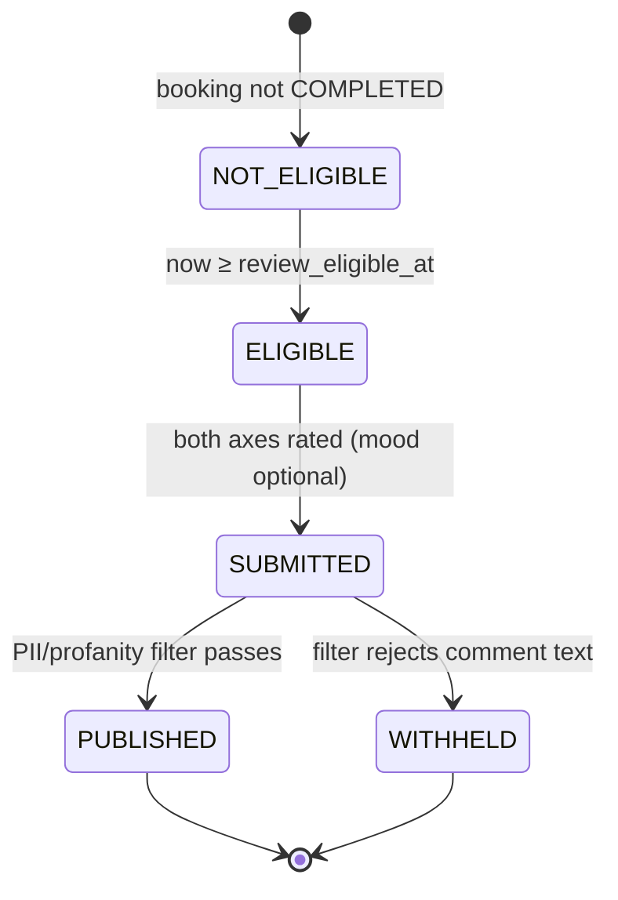

# Data Model

Persistence model for the LMNS prototype (SQLite). It is the source for `apps/api/src/db/schema.sql`; every object referenced by `docs/api-contract.md` appears here. The identity slice of this model is already implemented in the scaffold — the backend task extends the same file with the remaining tables.

## 1. Conventions

- SQLite, one file (`apps/api/data/lmns.db`, gitignored). No ORM; SQL lives in `apps/api/src/repos`.
- IDs are prefixed strings: `usr_…`, `app_…`, `evo_…`, `pkg_…`, `bkg_…`, `pay_…`, `thr_…`, `msg_…`, `ali_…`, `rev_…`, `mood_…`, `bdg_…`, `upr_…`, `cert_…`, `ntf_…`, `aud_…`. No UUID v4 — deterministic seed ids matter (`docs/seed-data.md`).
- Timestamps: `TEXT` ISO-8601 UTC. Money: `INTEGER` rupiah. Booleans: `INTEGER` 0/1 with `CHECK (x IN (0,1))`.
- Free-form JSON columns end in `_json` and hold a documented shape. Their keys are part of the contract; unknown keys are rejected at write time.
- Enumerations are `TEXT` with `CHECK` constraints (SQLite has no enum type).
- `PRAGMA foreign_keys = ON` and `journal_mode = WAL` are set on every connection (already in `apps/api/src/db/index.ts`).
- Derived values (ratings, counts, `missingItems`, flags) are computed on read; they are not stored caches except where noted.

## 2. Entity map

```
users ──1:1── mentee_profiles ──1:N── well_being_pulses
  │  └──1:N── sessions
  ├──1:0..1── mentors ──1:N── mentor_badges ──1:N── mentor_badge_events
  │             ├──1:N── storefront_packages
  │             ├──1:N── premium_upgrade_requests ──1:1── mentor_certificates
  │             ├──1:N── training_progress
  │             └──1:N── training_attempts
  └──1:N── mentor_applications ──1:N── application_evidence
                   ├──1:1── mentor_self_assessments
                   ├──1:0..1── mentor_storefronts ──1:N── storefront_packages
                   └──1:N── application_events

users(mentee) ──1:N── bookings ──1:1── mediation_threads ──1:N── mediation_messages
                        │      └──1:1── alignment_cards(implicit) ──1:3── alignment_items ──1:N── alignment_item_confirmations
                        ├──1:N── payments
                        ├──1:0..1── reviews ──1:0..1── mood_checks
                        └──1:N── books (mentor side: users(mentor) ──1:N── bookings)

institution_domains, otp_challenges, templated_reasons, audit_events, notifications  (standalone / user-scoped)
```

## 3. Tables

### 3.1 Identity and access

**`users`**

| Column | Type | Constraints |
|---|---|---|
| `id` | TEXT | PK |
| `email` | TEXT | NOT NULL, UNIQUE, lowercase |
| `role` | TEXT | NOT NULL, `CHECK IN ('MENTEE','MENTOR','ADMIN')` |
| `email_verified_at` | TEXT | NULL until OTP verified |
| `created_at` | TEXT | NOT NULL |

**`sessions`** — `token` TEXT PK, `user_id` → users(id) ON DELETE CASCADE, `created_at`.

**`institution_domains`** — `domain` TEXT PK (`ui.ac.id`), `institution_name` TEXT NOT NULL. Registration matches the email domain or any parent suffix in this table plus the configured suffix allowlist.

**`otp_challenges`**

| Column | Type | Constraints |
|---|---|---|
| `id` | TEXT | PK |
| `email` | TEXT | NOT NULL |
| `code_hash` | TEXT | NOT NULL; demo mode stores the configured OTP hashed, never a real secret |
| `expires_at` | TEXT | NOT NULL (`issued + 15 min`) |
| `consumed_at` | TEXT | NULL; single use |
| `attempts` | INTEGER | NOT NULL DEFAULT 0 |
| `created_at` | TEXT | NOT NULL |

Index: `(email, created_at DESC)` for the resend rate limit (3 per 15 min).

### 3.2 Mentee

**`mentee_profiles`** — `user_id` TEXT PK → users(id) ON DELETE CASCADE; `academic_level` `CHECK IN ('S1','S2','S3')`; `university`; `faculty_major`; `semester` INTEGER CHECK 1–14; `goals_json` TEXT NOT NULL DEFAULT `'[]'` (values from the fixed goal list in the API contract); `onboarding_completed_at` NULL until academic profile is complete.

**`well_being_pulses`** — `id` PK; `mentee_id` → users(id); `answers_json` NOT NULL (or `'{}'` when skipped); `skipped` 0/1; `created_at`. History is append-only: a re-prompt inserts a new row and never updates an old one. Latest row feeds matching only.

### 3.3 Mentor application

**`mentor_applications`**

| Column | Type | Constraints |
|---|---|---|
| `id` | TEXT | PK |
| `mentor_id` | TEXT | NOT NULL → users(id) |
| `tier` | TEXT | NOT NULL, `CHECK IN ('BASIC','EDUCATOR_STANDARD','EDUCATOR_PREMIUM')` |
| `status` | TEXT | NOT NULL, `CHECK IN ('DRAFT','PENDING_REVIEW','APPROVED','REJECTED','WITHDRAWN')` |
| `current_step` | TEXT | `CHECK IN ('IDENTITY','SELF_ASSESSMENT','STORE_FRONT','REVIEW')` |
| `submitted_at` | TEXT | NULL |
| `sla_due_at` | TEXT | `submitted_at + 3 business days` |
| `decided_at` | TEXT | NULL |
| `decision_reason_code` | TEXT | NULL → templated_reasons(code) |
| `decision_note` | TEXT | NULL |
| `created_at`, `updated_at` | TEXT | NOT NULL |

Index: `(status, submitted_at)`. At most one row per mentor with `status IN ('DRAFT','PENDING_REVIEW')` (enforced in the service; a partial unique index is acceptable).

**`application_evidence`** — `(application_id, key)` composite PK; `mentor_id` denormalized for authorization; `value` TEXT NOT NULL (URL or ID); `verified_at` NULL; `verified_by` NULL → users(id). Keys per tier are fixed by the API contract §7. One row per evidence key.

**`mentor_self_assessments`** — `application_id` PK → mentor_applications(id); `philosophy`, `boundaries`, `burnout_approach` TEXT NOT NULL; `completed_at`. Admin-only; never joined into public queries.

**`mentor_storefronts`** — `id` PK; `application_id` NULL → mentor_applications(id); `mentor_id` NULL → users(id); exactly one of the two is set; `niche`, `intro`, `well_being_philosophy` TEXT; `intro_video_url` NULL; `strengths_json`, `languages_json`, `formats_json`, `overseas_destinations_json` TEXT; `published` 0/1; `updated_at`. Approved mentors edit the row keyed by `mentor_id`; unpublished ones key by `application_id`.

**`storefront_packages`** — `id` PK; `storefront_id` → mentor_storefronts(id) ON DELETE CASCADE; `title`, `description`; `duration_minutes` INTEGER CHECK 30–180; `price_idr` INTEGER CHECK 0–5,000,000; `is_free_consultation` 0/1; `position` INTEGER.

**`application_events`** — `id` PK; `application_id` → mentor_applications(id); `status`; `actor_id`; `note`; `created_at`. Append-only history rendered in the applicant timeline.

### 3.4 Verified mentors, badges, upgrades

**`mentors`** — canonical listed profile. `user_id` TEXT PK → users(id); `slug` TEXT UNIQUE NOT NULL; `display_name`, `academic_title`, `institution`, `discipline` TEXT NOT NULL; `tier` `CHECK IN ('BASIC','EDUCATOR_STANDARD','EDUCATOR_PREMIUM')`; `status` `CHECK IN ('PENDING_REVIEW','APPROVED','REJECTED')` (kept in sync with the last application); `listed_at` TEXT NULL (set on approval); `session_fee_idr` INTEGER derived from packages; `languages_json`, `formats_json`, `research_focus_json`, `overseas_destinations_json`; `verified_links_json` (`googleScholar`, `linkedin`, `scopus`, `orcid`, `institutional`, `sisterId`); `source_application_id` → mentor_applications(id). Discovery reads **only** rows with `status = 'APPROVED'` **and** a verified `users.email_verified_at` (gate G2).

**`mentor_badges`** — `id` PK; `mentor_id` → users(id); `type` `CHECK IN ('SISTER_VERIFIED','SCOPUS_ORCID_VERIFIED','LMNS_WELL_BEING_CERTIFIED')`; `issued_at`; `issued_by` → users(id); `revoked_at` NULL; `revoke_reason` NULL; `status` `CHECK IN ('ACTIVE','REVOKED')`. Cards render only `ACTIVE` badges.

**`mentor_badge_events`** — `id` PK; `badge_id` → mentor_badges(id); `action` `CHECK IN ('ISSUE','REVOKE')`; `actor_id`; `reason`; `created_at`. Contract AC: badge issuance and revocation are logged with actor, timestamp, reason.

**`premium_upgrade_requests`** — `id` PK; `mentor_id` → users(id); `status` `CHECK IN ('DRAFT','PENDING_VERIFICATION','APPROVED','REJECTED')`; `submitted_at`, `decided_at`, `decided_by`, `decision_reason_code`, `decision_note`.

**`mentor_certificates`** — `id` PK; `upgrade_request_id` → premium_upgrade_requests(id); `file_name`, `issuer`, `file_url` (metadata/URL only — no binary storage), `issued_at`, `expires_at`; `verified_at` NULL, `verified_by` NULL, `status` `CHECK IN ('PENDING_VERIFICATION','VERIFIED','REJECTED')`.

**`training_modules`** — `id` PK; `title`, `content`, `duration_minutes`, `position`. Seeded, four rows.

**`training_progress`** — `(mentor_id, module_id)` PK; `completed_at` NOT NULL. **`training_attempts`** — `id` PK; `mentor_id`; `module_batch` TEXT; `score` INTEGER; `passed` 0/1; `answers_json`; `created_at` (one assessment attempt per row; pass = score ≥ 70).

### 3.5 Booking and payment

**`bookings`**

| Column | Type | Constraints |
|---|---|---|
| `id` | TEXT | PK |
| `mentee_id` | TEXT | NOT NULL → users(id) |
| `mentor_id` | TEXT | NOT NULL → users(id) |
| `package_id` | TEXT | NULL → storefront_packages(id) |
| `tier_snapshot` | TEXT | NOT NULL — tier at booking time |
| `session_fee_basis` | TEXT | NOT NULL, `CHECK IN ('RP_0','AGREED_IN_MEDIATION','PACKAGE_PRICE')` |
| `status` | TEXT | NOT NULL, `CHECK IN ('AWAITING_PAYMENT','PAYMENT_FAILED','PAID','SCHEDULED','COMPLETED','REVIEWED','CANCELLED')` |
| `platform_fee_idr` | INTEGER | NOT NULL, copied from config at creation |
| `intake_topic` | TEXT | NOT NULL, ≤ 200 |
| `intake_bottleneck` | TEXT | NOT NULL, ≤ 500 |
| `intake_stress_level` | INTEGER | CHECK 1–5 — **private to the mentee** |
| `created_at`, `paid_at`, `scheduled_at`, `completed_at`, `cancelled_at` | TEXT | |
| `cancel_reason` | TEXT | NULL |
| `review_eligible_at` | TEXT | `completed_at + 60 min` |

Indexes: `(mentee_id, created_at DESC)`, `(mentor_id, created_at DESC)`, `(status)`.

**`payments`** — `id` PK; `booking_id` → bookings(id); `provider` `CHECK IN ('QRIS','VIRTUAL_ACCOUNT','EWALLET')`; `ewallet` `CHECK IN ('GOPAY','OVO','DANA')` NULL unless provider is EWALLET; `amount_idr` INTEGER NOT NULL; `status` `CHECK IN ('PENDING','SUCCEEDED','FAILED','EXPIRED')`; `failure_code` NULL; `idempotency_key` TEXT UNIQUE (client or server generated, guarantees one settlement per intent); `instructions_json`; `receipt_number` TEXT UNIQUE NULL (set on success); `created_at`, `expires_at`, `paid_at`.

**`receipts`** — optional projection. The prototype serializes a receipt from the succeeded payment (`receipt_number`, `paid_at`, `amount_idr`, config `covers`); no separate table is required.

### 3.6 Mediation and alignment

**`mediation_threads`** — `id` PK; `booking_id` TEXT UNIQUE NOT NULL → bookings(id); `status` `CHECK IN ('OPEN','CLOSED')`; `opened_at`, `closed_at`. A row exists **only** after a successful platform-fee payment — the paid gate is structural, not a flag.

**`mediation_messages`** — `id` PK; `thread_id` → mediation_threads(id); `sender_id` → users(id); `body` ≤ 2000; `created_at`. Append-only.

**`alignment_items`** — `id` PK; `booking_id` → bookings(id); `key` `CHECK IN ('scope','schedule','fee')`; UNIQUE `(booking_id, key)`; `value_json` TEXT NULL until proposed; `version` INTEGER DEFAULT 0 (increments on every edit); `proposed_by` NULL → users(id); `proposed_at` NULL; `confirmed` 0/1 (derived convenience flag, recomputed from confirmations).

**`alignment_item_confirmations`** — `(item_id, user_id, item_version)` composite PK; `confirmed_at` NOT NULL. Confirming again on the same version is a no-op; bumping the item's version orphans old confirmations by design (re-confirmation required).

Three empty items are inserted when the thread opens, so the UI always renders the full card.

### 3.7 Reviews and mood

**`reviews`**

| Column | Type | Constraints |
|---|---|---|
| `id` | TEXT | PK |
| `booking_id` | TEXT | **UNIQUE** NOT NULL → bookings(id) — enforces one review per completed booking (G5) |
| `mentee_id`, `mentor_id` | TEXT | NOT NULL → users(id) |
| `academic_guidance` | INTEGER | NOT NULL, CHECK 1–5 |
| `well_being_support` | INTEGER | NOT NULL, CHECK 1–5 |
| `comment` | TEXT | NULL, ≤ 1000 |
| `status` | TEXT | NOT NULL, `CHECK IN ('PUBLISHED','WITHHELD')` |
| `created_at` | TEXT | NOT NULL |

No blended/average column exists anywhere. Public aggregates are `AVG()` over each axis separately.

**`mood_checks`** — `id` PK; `review_id` TEXT UNIQUE NULL → reviews(id); `booking_id` → bookings(id); `mentee_id` → users(id); `stress_level` INTEGER CHECK 1–5; `created_at`. Private to the mentee (G6). Never joined into mentor/admin/public read paths.

### 3.8 Operations and notifications

**`templated_reasons`** — `code` PK; `scope` `CHECK IN ('APPLICATION','UPGRADE','BADGE')`; `label`; `text` (Indonesian copy). Seeded.

**`audit_events`** — `id` PK; `entity_type` `CHECK IN ('APPLICATION','UPGRADE','BADGE','BOOKING')`; `entity_id`; `actor_id` → users(id); `action`; `reason_code` NULL; `note` NULL; `created_at`. Append-only; written for every admin decision and every badge issue/revoke.

**`notifications`** — `id` PK; `user_id` → users(id); `type` `CHECK IN ('OTP','APPLICATION_DECISION','BOOKING_PAID','ALIGNMENT_CONFIRMED','AGREEMENT_READY','REVIEW_PROMPT','BADGE_ISSUED')`; `payload_json`; `read_at` NULL; `created_at`.

## 4. State machines

### 4.1 Mentor application



| From | Event | Actor | Guard | Side effects |
|---|---|---|---|---|
| — | create | mentor | no `DRAFT`/`PENDING_REVIEW` application | insert row, `current_step = IDENTITY`, `application_events` row |
| `DRAFT` | submit | mentor | `EVIDENCE_MISSING`/`SELF_ASSESSMENT_REQUIRED`/`STOREFRONT_INCOMPLETE` all clear | `submitted_at = now`, `sla_due_at = +3 business days`, notification to admins |
| `PENDING_REVIEW` | approve | admin | checklist complete; status still `PENDING_REVIEW` | `mentors` row `APPROVED`, `listed_at`, storefront `published = 1`, audit row, applicant notification |
| `PENDING_REVIEW` | reject | admin | `reasonCode` from `templated_reasons`; status still `PENDING_REVIEW` | `decision_reason_code/note`, audit row, applicant notification with reason text |
| `PENDING_REVIEW` | withdraw | mentor | — | `WITHDRAWN`, event row |
| `REJECTED`/`WITHDRAWN` | edit | mentor | — | back to `DRAFT`, evidence editable, decision fields cleared on next submit |
| `APPROVED` | premium upgrade | mentor | see §4.5 | tier changes only via badge issuance |

Invariants: verified academic evidence is immutable while `PENDING_REVIEW` (edit request → `409 INVALID_APPLICATION_STATE`); an approved application is never edited — storefront edits go through `/api/mentor/storefront`.

### 4.2 Booking and mediation



| From | Event | Actor | Guard | Side effects |
|---|---|---|---|---|
| — | create | mentee | `users.email_verified_at` set (G1); mentor `APPROVED` and verified (G2); no open booking with the same mentor | booking + first `PENDING` payment, `platform_fee_idr` from config |
| `AWAITING_PAYMENT` | pay-confirm | mentee | payment belongs to booking | payment `SUCCEEDED`, receipt number, `paid_at`, `mediation_threads` row `OPEN`, three `alignment_items`, notification to both |
| `AWAITING_PAYMENT`/`PAYMENT_FAILED` | pay-confirm failure | mentee | `testOutcome = FAILURE` | payment `FAILED`, booking `PAYMENT_FAILED`; no thread row |
| `PAID` | align-item confirm | participant | current item version | confirmation row; if all 3 items confirmed by both → `SCHEDULED`, `scheduled_at` from `schedule` value |
| `SCHEDULED` | align-item edit | participant | — | item version +1, all confirmations for that item cleared → `PAID` |
| `SCHEDULED` | complete | participant | — | `COMPLETED`, `completed_at`, `review_eligible_at = +60 min`, review-prompt notification |
| `COMPLETED` | review submit | mentee (owner) | `now ≥ review_eligible_at`; no existing review (G5) | review row, booking `REVIEWED` |
| any non-terminal | cancel | participant | not `COMPLETED`/`REVIEWED` | `CANCELLED`, thread `CLOSED`, `cancel_reason` |

Structural gates: the mediation thread row cannot exist before payment (G3); `SCHEDULED` is unreachable without bilateral confirmation on the current item versions (G4).

### 4.3 Alignment item



### 4.4 Review



| State | Meaning | Who sees the review |
|---|---|---|
| `NOT_ELIGIBLE` | Booking not `COMPLETED`, or 60-minute window not elapsed | nobody; `GET /api/bookings/:id/review` returns `eligible: false` with reason |
| `ELIGIBLE` | Prompt available from the booking record and the notification | nobody |
| `SUBMITTED` | Row created; both axes stored independently | mentee (`GET /api/me/reviews`) |
| `PUBLISHED` | Visible on the mentor page and in aggregates | public |
| `WITHHELD` | Text failed the filter; ratings may still aggregate per prototype policy | mentee only |

One review per booking is enforced by `UNIQUE (booking_id)`; a second submission is `409 REVIEW_ALREADY_SUBMITTED`. Mood checks are a separate, private row and never appear in any review response.

### 4.5 Payment and badge

```
Payment: PENDING → SUCCEEDED | FAILED | EXPIRED        (idempotent on idempotency_key)
Badge:   NOT_ISSUED → PENDING_VERIFICATION → ISSUED → REVOKED
                    (upgrade submitted)      (admin verifies certificate + all preconditions)
REVOKED → ISSUED on re-verification; every transition writes mentor_badge_events.
```

Badge issuance preconditions (all must be `VERIFIED`): training modules complete, assessment passed, S3 verified, overseas experience verified, coaching certificate verified. The tier becomes `EDUCATOR_PREMIUM` in the same transaction (G7).

## 5. Visibility matrix

| Data | Mentee (owner) | Mentor | Admin | Public |
|---|---|---|---|---|
| `well_being_pulses.answers_json` | read | — | — | — |
| `bookings.intake_stress_level` | read | — (omitted) | — (omitted) | — |
| `mood_checks.stress_level` | read | — | — | — |
| `mentor_self_assessments` | — | own (write only) | read | — |
| `application_evidence` | — | own | read | public links only where the profile publishes them |
| `storefront`, `packages` | read | own write | read | read (approved only) |
| `reviews` (axes, comment) | own write/read | read (aggregate + published) | read | published only |
| `payments`, receipts | own | own (booking participant) | read | — |
| `audit_events` | — | — | read | — |
| `otp_challenges` | — | — | — | — |

Redaction is a serializer concern (`serializeBooking(booking, viewerRole)`); no read path may select private columns and filter later in the browser.

## 6. Open decisions deferred to implementation

- Business-day calculation for `sla_due_at` assumes Mon–Fri in `Asia/Jakarta`; the prototype may use calendar days plus a 3-day constant and document the difference in the UI.
- `mentors.session_fee_idr` is "starting fee": minimum non-free package price, or `0` when the mentor offers a free consultation.
- Review `WITHHELD` still contributing to aggregates is a prototype simplification; the alternative (exclude from aggregates) is a one-line `WHERE status = 'PUBLISHED'`.
- Full-text search is `LIKE`-based across name/institution/discipline/niche at prototype scale; FTS5 is an upgrade, not a requirement.
